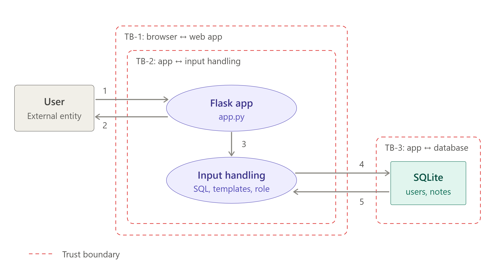

# Term Project Report — Secure Build

> Fill in every section and keep the headings. Each section names its owner in an HTML
> comment; the owner drafts it, a teammate reviews it. Remove the comments before submission.

## Cover

| Field | Value |
|---|---|
| Team name | Bytes |
| Members (name + ID) | Thura Aung (6631503094) · Pyae Shunn Le Maung (6631503084) · Nang Yu Yu Khay (6631503078) |
| Target application | NoteVault (course starter app) |
| Repository URL | https://github.com/ThuraAung6631503094/software-security-project-bytes |
| Video URL | https://drive.google.com/drive/folders/19dseKPoRew2BsUetORD8JoJAo8ULehvp?usp=sharing |
| Baseline | tag `vulnerable-baseline` |
| Date | 2026-11-05 |

## AI-tool usage disclosure

| Tool | Who | How it was used |
|---|---|---|
| Claude Code (Anthropic) | Thura Aung | Set up the repository structure, task split and report outline; drafted evidence-log templates, reproduction/fix guidance and this report. The team ran all testing, captured all evidence, and reviewed every change. |
| | | <!-- Person 2 / Person 3: add your own tools and usage, or "None". --> |

---

## 1. Executive Summary

NoteVault is a small Flask note-sharing web app and JSON API backed by SQLite, run locally in
Docker. It supports registration, login (cookie/JWT session), note creation, search, an admin
user list and an export endpoint.

Assessing the `vulnerable-baseline` build, the team confirmed **17 findings: 3 Critical, 10
High and 4 Medium**. The most serious were a forgeable administrator session (the signing
secret was committed in source), server-side template injection and OS command injection (both
leading to code execution), SQL injection in login and search, broken access control
(self-assigned admin role and an IDOR), weak MD5 password storage, an insecure (root, unpinned,
secret-baked) container, and a vulnerable dependency stack carrying a Critical PyJWT CVE.

Every finding was remediated in per-owner branches and re-verified against its original exploit.
The fixes move the signing secret to runtime configuration and restrict JWT to HS256 with an
expiry, parameterise all SQL, enforce note ownership and a fixed registration role, add a unique
username constraint, escape all rendered output (removing `|safe` and string-built templates),
remove shell execution, replace MD5 with Werkzeug adaptive hashing, stop exposing password
hashes, add CSRF protection and secure cookie attributes, disable debug mode, harden the
container (non-root, pinned, minimal, no baked secret), upgrade dependencies, and remove the
committed hash file. A CycloneDX SBOM was generated and a release artifact was signed and
verified with Cosign. The security CI pipeline moved from **failing on the baseline** to
**passing all six jobs** on the remediated code.

**Residual risk** is low and documented: the baseline secrets remain in earlier git history
(the seed passwords are now strongly hashed; full history rewrite / credential rotation is a
recommended follow-up), and the image base is pinned by tag with a documented path to a digest
pin.

---

## 2. System Scope & Function

NoteVault is a Flask application that stores users and notes in SQLite (`/tmp/notevault.db`) and
runs locally in a Docker container published on `127.0.0.1:8080`.

**In-scope components**
- `starter-app/app.py` — routes, authentication, authorization, DB access, rendering, export
- `starter-app/requirements.txt` — Python dependencies
- `starter-app/Dockerfile`, `starter-app/docker-compose.yml` — image build and local run
- `.github/workflows/security-ci.yml` — SAST, SCA, secret/misconfig and container scanning, SBOM

**In-scope endpoints:** `/`, `/register`, `/login`, `/logout`, `/notes`, `/api/notes/<id>`,
`/search`, `/admin`, `/export`.

**Data-Flow Diagram & trust boundaries:** see `docs/threat-model/dfd.png`
(editable source `docs/threat-model/dfd.md`).



Trust boundaries: **TB-1** browser ↔ web app, **TB-2** app ↔ input handling (SQL/templates/role),
**TB-3** app ↔ SQLite, **TB-4** source repo → CI runner, **TB-5** CI runner → released image/artifacts.

### Baseline environment
- Branch `main`; baseline tag `vulnerable-baseline`
- Runtime: Docker Compose, `http://localhost:8080`
- Seeded sandbox accounts: `alice`/`alicepw`, `admin`/`admin123`
- Per-team marker: configured via `TEAM_ID` (`TEAM_BYTES`)

---

## 3. Threat Model — STRIDE  *(20 pts)*

Full STRIDE analysis in `docs/threat-model/stride.md`. Summary of elements and top threats:

| Element / data flow | Top STRIDE threat | Finding(s) | Mitigation |
|---|---|---|---|
| Browser → login / session token | Spoofing, Elevation | AUTH-01, AUTH-02, AUTH-04 | Runtime secret, HS256+exp, parameterised SQL, secure cookies |
| Browser → register | Elevation | AC-01, AC-02 | Server-set role, unique username |
| Browser → notes / search | Tampering, Info disclosure, Elevation | AC-03, INJ-01, INJ-02, INJ-03 | Ownership checks, parameterised SQL, escaped template data |
| Browser → export → shell | Elevation | INJ-04 | Allowlist format, no shell |
| Flask → SQLite | Info disclosure | INJ-01, AC-03, INFO-01 | Parameterised queries, minimal responses |
| App runtime / container | Info disclosure, Elevation | CFG-01, CFG-02 | debug off, localhost bind, non-root, minimal image |
| Repo → CI → image | Tampering (supply chain) | SC-01, SEC-01 | Upgrade/trim deps, remove secrets, scan + sign in CI |

### Top-5 risks (likelihood × impact)

| Rank | Risk | Likelihood | Impact | Rating |
|---|---|---|---|---|
| 1 | AUTH-01 — forged administrator session | High | Critical | **Critical** |
| 2 | INJ-03 — server-side template injection (code execution) | Medium | Critical | **High** |
| 3 | INJ-04 — OS command injection (code execution) | Medium | Critical | **High** |
| 4 | AUTH-02 / INJ-01 — SQL injection (login & search) | High | High | **High** |
| 5 | AC-01 / AC-03 — broken access control (role self-assign & IDOR) | High | High | **High** |

---

## 4. Vulnerability Findings  *(25 pts)*

Severity uses Critical/High/Medium; OWASP mapping uses **OWASP Top 10:2025**. Evidence for each
finding is in `evidence/<ID>/` (`exploit.txt` + `exploit.png`).

### Person 1 — Authentication, sessions & crypto

**AUTH-01 — Forged administrator session token** · Critical · OWASP **A07:2025 Authentication
Failures** · CWE-798, CWE-347, CWE-613
The signing secret `notevault-dev-secret` was committed in `app.py`, `current_user()` accepted
the `none` algorithm, and tokens had no expiry. A token with `sub=admin` signed with the public
secret, sent as the session cookie, returned admin data from `/admin` (HTTP 200).

**AUTH-02 — SQL injection in login** · High · **A05:2025 Injection** · CWE-89
`login()` interpolated the username into the SQL string. `username=' OR 1=1 -- ` returned a user
row without valid credentials and issued a session (HTTP 302).

**AUTH-03 — Unsalted MD5 password storage** · High · **A04:2025 Cryptographic Failures** ·
CWE-327, CWE-916
Passwords were stored as unsalted MD5 (stored digests matched `MD5("alicepw")` /
`MD5("admin123")` exactly), trivially reversible.

**AUTH-04 — Session cookie missing security attributes** · Medium · **A07:2025 Authentication
Failures** · CWE-614, CWE-1004
The `session` cookie was set with no HttpOnly, Secure or SameSite attributes.

**AUTH-05 — Missing CSRF protection** · Medium · **A01:2025 Broken Access Control** · CWE-352
State-changing POSTs (`/notes`, `/register`, `/login`) accepted requests with no anti-CSRF token.

**INFO-01 — Admin endpoint discloses password hashes** · Medium · **A04:2025 Cryptographic
Failures** · CWE-200, CWE-522
`/admin` selected and serialised the `password` column, returning every user's hash to the client.

### Person 2 — Access control & input handling

**AC-01 — Client-chosen role at registration** · High · **A01:2025 Broken Access Control** ·
CWE-269, CWE-915
`register()` took `role` from the request; `role=admin` created an administrator account.

**AC-02 — Account takeover via duplicate usernames** · High · **A07:2025 Authentication
Failures** · CWE-287
`username` had no UNIQUE constraint; registering a second `admin` with a chosen password, then
logging in, granted admin (the role lookup resolved to the original admin row).

**AC-03 — IDOR on note API** · High · **A01:2025 Broken Access Control** (API1:2023 BOLA) ·
CWE-639
`/api/notes/<id>` filtered only by ID; as alice, `/api/notes/2` returned admin's note (HTTP 200).

**INJ-01 — SQL injection in search** · High · **A05:2025 Injection** · CWE-89
`search()` interpolated owner and term into SQL; `%' OR owner='admin' -- ` returned admin's notes.

**INJ-02 — Stored XSS** · High · **A05:2025 Injection** · CWE-79
Notes were concatenated into raw HTML rendered with `|safe`; a stored
`` executed on the home page.

**INJ-03 — Server-side template injection in search** · Critical · **A05:2025 Injection** ·
CWE-1336, CWE-94
`search()` concatenated note content into the template string passed to
`render_template_string`; a note containing `{{7*7}}` rendered as `49`, proving server-side
evaluation (escalatable to code execution).

### Person 3 — Platform, CI & supply chain

**INJ-04 — OS command injection in export** · Critical · **A05:2025 Injection** · CWE-78
`export()` passed the `fmt` parameter into `subprocess.run(..., shell=True)`; `fmt=txt;id`
executed the injected command (as root in the container).

**CFG-01 — Debug mode & broad network exposure** · High · **A02:2025 Security Misconfiguration**
(and A10:2025 Mishandling of Exceptional Conditions) · CWE-489, CWE-16
`debug=True`, `host=0.0.0.0`, and a compose port published on all interfaces; an unhandled error
returned the Werkzeug debugger/traceback.

**CFG-02 — Insecure container image** · High · **A02:2025 Security Misconfiguration** · CWE-250,
CWE-16
The image ran as root, used an unpinned base, baked `ENV APP_SECRET`, and `COPY . .` shipped the
whole context.

**SC-01 — Vulnerable & outdated dependencies** · High · **A03:2025 Software Supply Chain
Failures** · CWE-1104, CWE-1395
Trivy reported 17 findings (16 HIGH, 1 CRITICAL — PyJWT CVE-2026-102268 auth bypass) across the
pinned stack; `requests`/`urllib3` were declared but unused.

**SEC-01 — Password hashes committed to the repo and image** · Medium · **A02:2025 Security
Misconfiguration** (and A03 supply chain) · CWE-540, CWE-200
`project_hashes.txt` (MD5 of the seed passwords) was committed and shipped in the image via
`COPY . .`.

---

## 5. Remediation  *(25 pts)*

Each finding was fixed in a per-owner branch with one-finding commits, then its original exploit
was re-run and blocked (`evidence/<ID>/fixed.txt` + `fixed.png`). Merge order respected the
dependency upgrade landing first.

| Finding(s) | Fix | Branch / PR |
|---|---|---|
| SC-01 | Upgrade Flask/Werkzeug/Jinja2/PyJWT; drop unused `requests`/`urllib3` | `fix/person3-platform` (#6) |
| INJ-04 | Remove shell; allowlist `txt` format only | `fix/person3-platform` (#6) |
| CFG-01 | `debug=False`, host/port from env, generic 404/500 handlers, compose binds `127.0.0.1` | `fix/person3-platform` (#6) |
| CFG-02 | Slim base, non-root `uid 10001`, no baked secret, minimal COPY, `.dockerignore`, OS patch | `fix/person3-platform` (#6), `fix/person3-container-os-patch` (#8) |
| SEC-01 | Delete `project_hashes.txt`; `.dockerignore` keeps it out of the image | `fix/person3-platform` (#6) |
| AC-01 | Registration always assigns `user`; validate input | `fix/person2-access` (#7) |
| AC-02 | UNIQUE username; duplicate registration returns 409 | `fix/person2-access` (#7) |
| AC-03 | `/api/notes/<id>` filters by ID **and** owner | `fix/person2-access` (#7) |
| INJ-01 | Parameterised search query | `fix/person2-access` (#7) |
| INJ-02 / INJ-03 | Notes passed to Jinja as data; no `\|safe`, fixed template string (one change fixes both) | `fix/person2-access` (#7) |
| AUTH-01 | `NOTEVAULT_SECRET` from env; HS256 only (no `none`) + `exp`; separate auth cookie | `fix/person1-auth-fixes` (#9) |
| AUTH-02 | Parameterised login lookup; verify hash in Python | `fix/person1-auth-fixes` (#9) |
| AUTH-03 | Werkzeug adaptive salted hashing (seed/register/login) | `fix/person1-auth-fixes` (#9) |
| AUTH-04 | Cookie HttpOnly + SameSite (Secure under HTTPS) | `fix/person1-auth-fixes` (#9) |
| AUTH-05 | Flask-WTF CSRFProtect + `csrf_token` in forms | `fix/person1-auth-fixes` (#9) |
| INFO-01 | `/admin` returns only id, username, role | `fix/person1-auth-fixes` (#9) |

**Representative before/after**

```diff
# AUTH-01 / AUTH-02 / AUTH-03 (app.py)
- SECRET = "notevault-dev-secret"
- data = jwt.decode(tok, SECRET, algorithms=["HS256", "none"])
- q = "SELECT * FROM users WHERE username = '%s' AND password = '%s'" % (username, md5(password))
+ SECRET = os.environ["NOTEVAULT_SECRET"]            # required at runtime
+ data = jwt.decode(tok, SECRET, algorithms=["HS256"])   # 'none' removed; exp enforced
+ row = con.execute("SELECT * FROM users WHERE username = ?", (username,)).fetchone()
+ if not row or not check_password_hash(row["password"], password or ""): return "login failed", 401
```

---

## 6. Supply-Chain Hardening  *(15 pts)*

- **SBOM (CycloneDX):** `evidence/supply-chain/sbom.json`, generated from `requirements.txt`.
  *Note: regenerate after the final auth fix so it includes `Flask-WTF` (the committed SBOM was
  produced during the dependency-upgrade step and lists Flask, Werkzeug, Jinja2, PyJWT).*
- **Signed artifact:** the SBOM release artifact was signed and verified with **Cosign**
  (ephemeral local key; private `cosign.key` kept out of git). Verification result
  `Verified OK` — `evidence/supply-chain/cosign-verify.txt`; public key `cosign.pub`; bundle
  `notevault.bundle`.
- **Image digest:** `evidence/supply-chain/image-digest.txt`
  (`sha256:4506cd1fa493ea049eeb296f89079fa667202eda3a13ae179d1fcd5a491224ee`).
- **SLSA self-assessment:** the project demonstrates partial **Level 1** practices — a scripted
  GitHub Actions build, a generated SBOM, a signed artifact and a reviewable commit history. It
  is not claimed higher because it does not yet produce a verified hosted provenance attestation
  for the released image; signing the immutable registry digest and publishing provenance is the
  next step.

---

## 7. Security CI Pipeline  *(10 pts)*

- **Workflow:** `.github/workflows/security-ci.yml` — six jobs: Python compile, Semgrep (SAST),
  Trivy fs (SCA + secret + misconfig), Gitleaks (history secrets), Trivy image scan, CycloneDX SBOM.
- **Gate behaviour:** Semgrep runs `--severity ERROR --error`; both Trivy jobs use
  `severity: HIGH,CRITICAL` with `exit-code: 1` and `ignore-unfixed`. Any HIGH/CRITICAL fails the build.
- **Baseline run:** failed on the vulnerable code (Semgrep flagged the hardcoded secret, SQL
  string-building, `|safe`/templating and MD5). Evidence `evidence/ci/baseline-failure.png`.
  *(A workflow bug pinned `trivy-action@0.28.0`, which did not resolve, so the two Trivy jobs
  initially errored at setup; this was corrected to the valid `v0.36.0` pin in PR #10.)*
- **Final run:** after all fixes and the CI pin correction, **all six jobs pass** —
  `evidence/ci/final-success.png`.

---

## 8. Conclusion & Reflection  *(5 pts — clarity)*

The team took NoteVault from an intentionally vulnerable baseline to a build with parameterised
database access, enforced authorization and ownership, escaped rendering, CSRF protection,
runtime secret injection, adaptive password hashing, a non-root hardened container, upgraded
dependencies, an SBOM and a signed artifact — proven by a security pipeline that fails on the
baseline and passes on the remediated code.

Key lessons: (1) controls must be tested together — adding CSRF surfaced a cookie-name collision,
resolved by separating Flask's session cookie from the JWT auth cookie; (2) a dependency upgrade
is itself a change that can break behaviour (PyJWT 2.x, Flask 3.x request handling), so it was
merged first; (3) CI only protects you if the actions actually run — a bad action pin silently
disabled a gate until caught.

**Residual risk / future work:** rewrite git history to purge the baseline secrets and rotate the
seed credentials; pin the base image by digest; add audit logging (A09), rate limiting and HTTPS;
publish verified build provenance (SLSA L2+); and regenerate the SBOM to include Flask-WTF.

---

## Appendix

- **Tools:** Docker Compose, PowerShell, curl, Burp-style browser DevTools, Semgrep, Trivy,
  Gitleaks, CycloneDX, Cosign, GitHub Actions.
- **References:** OWASP Top 10:2025; OWASP API Security Top 10; CWE-78, 79, 89, 94, 200, 250,
  269, 287, 327, 347, 352, 489, 522, 540, 613, 614, 639, 798, 915, 916, 1004, 1104, 1336.
- **Task split (past tense):**
  - *Thura Aung (Person 1, repo lead):* repository setup, conventions and CI-pin fix; AUTH-01…05
    and INFO-01 findings, fixes and evidence; executive summary, threat-model assembly and top-5 ranking.
  - *Pyae Shunn Le Maung (Person 2):* data-flow diagram; AC-01…03 and INJ-01…03 findings, fixes and
    evidence; system scope section; report editing.
  - *Nang Yu Yu Khay (Person 3):* INJ-04, CFG-01/02, SC-01, SEC-01 findings, fixes and evidence;
    the security CI pipeline; CycloneDX SBOM and Cosign signing.
- **Ethics:** all exploitation was performed only against the authorized local NoteVault sandbox;
  no public deployment, real credentials or external target was used.

---

## Grading rubric (100)

| Criterion | Pts |
|---|---|
| Threat model quality & completeness (§3) | 20 |
| Vulnerability findings — correctness, CWE/OWASP mapping, depth (§4) | 25 |
| Remediation quality — correct, minimal, well-explained (§5) | 25 |
| Supply-chain hardening — SBOM + signing + provenance (§6) | 15 |
| CI pipeline — works, fails build appropriately (§7) | 10 |
| Presentation & report clarity (§1, §8) | 5 |

*All work stays within the course ethics policy: local sandbox only.*
