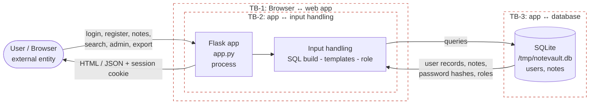

# Data-flow diagram (DFD) — editable source

This Mermaid diagram is the editable source for the DFD. Render it to `dfd.png` (see below)
and reference that image in REPORT.md §2.

Scope note: TB-1..TB-3 cover the running application (Person 2's area). TB-4/TB-5 (source →
CI → released image) are added by Person 3.

## Trust boundaries

- **TB-1 Browser ↔ web app** — untrusted client input crosses into the application
  (login, registration, notes, search, admin, export).
- **TB-2 app ↔ input handling** — where raw input reaches SQL construction, template
  rendering, and the role/authorization decision (the home of INJ-01/02/03, AC-01).
- **TB-3 app ↔ database** — queries and stored records (users, notes, password hashes).
- **TB-4 / TB-5** — source repo → CI runner → released image/artifacts (added by Person 3).

## How to export to dfd.png

- Easiest: open <https://mermaid.live>, paste the code block above, and use **Actions →
  PNG** to download. Save it here as `dfd.png`.
- Or in VS Code: install a Mermaid preview/export extension, open this file, export the
  diagram as PNG.

Keep both the `.md` (editable source) and the exported `dfd.png` in this folder.
